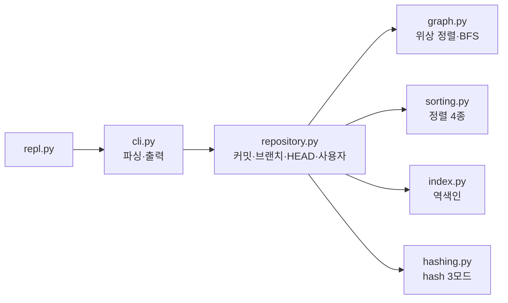

# mini-git

> Git-inspired CLI that models commits as a DAG, with BFS path finding, ancestor traversal, inverted-index search, and custom sorting algorithms in Python
> 커밋을 DAG로 구성하고 최단 경로 탐색, 조상 탐색, 역색인 검색, 정렬 알고리즘을 직접 구현한 Python 기반 Mini Git


**No `sorted()` / `list.sort()` / graph libraries used.**
위상 정렬, BFS 최단 경로, 조상 탐색, 역색인, 정렬 알고리즘 4종을 직접 구현했습니다. 금지 API를 쓰지 않았는지는 AST 분석 테스트([`tests/test_constraints.py`](tests/test_constraints.py))가 자동으로 확인합니다.

```
mini-git> init "Alice"
Initialized repository.
Current branch: main
Current user: Alice
mini-git> commit "Initial commit"
[main 0000001] Initial commit
mini-git> branch feature
Created branch: feature
mini-git> switch feature
Switched to branch: feature
mini-git> commit "Add login feature"
[feature 0000002] Add login feature
mini-git> switch main
Switched to branch: main
mini-git> commit "Add payment feature"
[main 0000003] Add payment feature
mini-git> log
commit 0000001 (Alice, 2024-01-15 09:00:00) [main]
Initial commit
commit 0000002 (Alice, 2024-01-15 09:15:00) [feature] (feature)
Add login feature
commit 0000003 (Alice, 2024-01-15 09:30:00) [main] (HEAD -> main)
Add payment feature
mini-git> path 0000002 0000003
Path: 0000002 -> 0000001 -> 0000003
(2 edges)
mini-git> search login
Found 1 commit:
- 0000002: Add login feature (Alice, 2024-01-15 09:15:00)
```

## 목차

- [빠른 시작](#빠른-시작)
- [명령어](#명령어)
- [동작 원리 요약](#동작-원리-요약)
- [요구사항 구현 매핑](#요구사항-구현-매핑)
- [선택(보너스) 과제 구현 내역](#선택보너스-과제-구현-내역)
- [프로젝트 구조](#프로젝트-구조)
- [테스트와 성능 측정](#테스트와-성능-측정)
- [문서](#문서)

## 빠른 시작

외부 라이브러리 없이 Python 3.10 이상만 있으면 됩니다. 기준 버전은 3.14(`.python-version`)이고, [uv](https://docs.astral.sh/uv/) 를 쓰면 `uv run python ...` 으로 같은 버전에서 실행됩니다.

```bash
git clone https://github.com/maebsy/mini-git.git
cd mini-git
python main.py
```

| 실행 옵션 | 설명 |
| --- | --- |
| `--hash-mode sha1` (기본) | 커밋 내용의 SHA-1 앞 7자리 (실제 Git과 같은 내용 기반) |
| `--hash-mode counter` | `0000001`, `0000002` … 순번 기반 (예측 가능, 테스트·문서용) |
| `--hash-mode random --seed 42` | 난수 기반, 시드를 주면 재현 가능 |
| `--fake-time "2024-01-15 09:00:00" --time-step 900` | 커밋 시각을 지정한 시각부터 15분씩 증가 (예시 재현용) |

준비된 시나리오를 실행하면 프롬프트와 결과가 함께 출력됩니다. 이 README의 예시는 모두 아래 옵션으로 실제 실행한 결과입니다.

```bash
OPTS='--hash-mode counter --fake-time "2024-01-15 09:00:00" --time-step 900'
eval python main.py $OPTS < examples/01_mission_example.txt   # 과제 결과 예시 흐름
eval python main.py $OPTS < examples/02_graph.txt             # merge DAG에서 LOG/PATH/ANCESTORS
eval python main.py $OPTS < examples/03_search_sort.txt       # 역색인 검색과 정렬
eval python main.py $OPTS < examples/04_errors.txt            # 표준 에러
eval python main.py $OPTS < examples/05_bonus_merge_diff.txt  # [보너스] MERGE, DIFF
```

Windows PowerShell에서는 `Get-Content examples\01_mission_example.txt | python main.py --hash-mode counter --fake-time "2024-01-15 09:00:00" --time-step 900`처럼 실행합니다.

## 명령어

명령어는 대소문자를 구분하지 않고, 공백이 있는 인자는 따옴표로 감쌉니다. 커밋을 가리킬 때는 전체 hash, 4자 이상 축약 hash, 브랜치 이름을 모두 쓸 수 있습니다.

### 필수 명령어

| 명령어 | 출력 예 | 설명 |
| --- | --- | --- |
| `INIT <user_name>` | `Initialized repository.` | main 브랜치 생성, HEAD 설정, 현재 사용자 설정 |
| `BRANCH <branch_name>` | `Created branch: feature` | 현재 HEAD 커밋을 가리키는 브랜치 생성 |
| `SWITCH <branch_name>` | `Switched to branch: feature` | HEAD를 브랜치로 이동 |
| `COMMIT <message>` | `[main 0000001] Initial commit` | 현재 HEAD를 부모로 커밋 생성 + 역색인 갱신 |
| `LOG` | `commit <hash> (<author>, <time>) [<branch>]` | 부모가 항상 자식보다 먼저 (위상 정렬) |
| `LOG --sort-by=date\|author` | | 직접 구현한 병합 정렬(안정)로 정렬 |
| `PATH <commit1> <commit2>` | `Path: a -> b -> c` / `No path` | 무방향 최단 경로, 동률이면 사전순 최소 |
| `ANCESTORS <commit_hash>` | `- <hash> [distance 1] ...` | 도달 가능한 모든 조상 (가까운 순) |
| `SEARCH <keyword>` | `Found 1 commit:` | 키워드 역색인 검색 (여러 단어는 AND) |
| `SEARCH --author=<name>` | | 작성자 역색인 검색 |
| `exit` / `quit` | | 종료 |

### 표준 에러

| 출력 | 상황 |
| --- | --- |
| `Invalid args` | 인자 개수·형식 오류 (필요하면 `: 이유`) |
| `Unknown branch: <name>` | 없는 브랜치 |
| `Unknown commit: <hash>` | 없는 커밋 |
| `Not initialized. Run: INIT <user_name>` | INIT 전 명령 |

### 확장 명령어·옵션

| 명령어 | 설명 |
| --- | --- |
| `BRANCH` | 브랜치 목록 (`*` = 현재) |
| `SWITCH --orphan <name>` | 커밋이 없는 새 브랜치 → 연결되지 않은 그래프로 `No path` 재현 |
| `USER [<name>]` | 현재 작성자 확인/변경 (여러 작성자 검색·정렬 시연용) |
| `STATUS` | 현재 브랜치, HEAD, 커밋·색인 통계 |
| `LOG --sort-by=... --algo=merge\|quick\|heap\|insertion` | 정렬 알고리즘 교체 |
| `LOG --sort-by=author --topo` | 작성자순을 따르되 부모-자식 순서 유지 (체크리스트 4-3) |
| `HELP` | 명령어 목록 |

## 동작 원리 요약

| 기능 | 알고리즘 | 복잡도 | 핵심 아이디어 |
| --- | --- | --- | --- |
| LOG | Kahn 위상 정렬 + 직접 만든 우선순위 큐 | O((V+E) log V) | 부모를 모두 출력한 커밋만 출력 가능. 후보가 여럿이면 가장 오래된 것 |
| PATH | target에서 BFS → greedy 복원 | O(V+E) | 남은 거리가 1 줄어드는 이웃 중 hash가 가장 작은 것 → 사전순 최소 경로 |
| ANCESTORS | 부모 방향 BFS + 방문 표시 | O(V+E) | merge로 여러 경로가 있어도 한 번만 |
| SEARCH | 역색인 (keyword/author → hash 목록) | O(1) + O(k) | 커밋할 때 미리 색인. 검색은 전체를 보지 않음 |
| LOG 정렬 | 바텀업 병합 정렬 | O(n log n) | 안정 정렬 → 같은 작성자 안에서 시간순 유지 |
| 커밋 조회 | `dict[hash → Commit]` | 평균 O(1) | hash 생성 시 존재 여부를 검사해 유일성 보장 |



알고리즘 모듈은 저장소를 모르고 "이웃을 알려주는 함수"만 받습니다. 그래서 같은 BFS를 PATH(무방향), ANCESTORS·MERGE(부모 방향)가 함께 씁니다. 자세한 내용은 [`docs/design.md`](docs/design.md)에 있습니다.

## 요구사항 구현 매핑

| 요구사항 | 구현 | 검증 |
| --- | --- | --- |
| 커밋 노드 (hash, message, author, timestamp, parents) | [`models.py`](mini_git/models.py) `Commit` (불변 데이터클래스) | — |
| 0개 이상 부모, DAG | [`repository.py`](mini_git/repository.py) `_new_commit`, merge는 부모 2개 | 무작위 300회 조작 후 DAG 검사 |
| hash로 빠른 조회, 세션 내 유일 | `commits: dict`, [`hashing.py`](mini_git/hashing.py) 존재 검사 + 확장 | 모드별 500개 유일성, 강제 충돌 |
| 역색인 2종 (keyword, author) | [`index.py`](mini_git/index.py) | `tests/test_index.py` |
| split + lower 키워드 추출 | `index.tokenize` (+ 문장부호 제거) | `test_split_lower_strip_punct_dedupe` |
| 정렬 직접 구현, 비교 기준 변경 | [`sorting.py`](mini_git/sorting.py) `key=` 함수 | 정확성·안정성·키 호출 횟수 |
| LOG 부모 먼저 | [`graph.py`](mini_git/graph.py) `topological_order` | 무작위 DAG 50개 |
| PATH 무방향 최단 + 사전순 동률 | `graph.shortest_path` | 전수 탐색 정답지와 무작위 80개 비교 |
| ANCESTORS 빠짐없이 | `graph.ancestors` | DFS 정답과 무작위 50개 비교 |
| 대소문자 무시, 따옴표, `--옵션=값`, 표준 에러 | [`cli.py`](mini_git/cli.py) | `tests/test_cli.py` |
| REPL `mini-git>`, exit/quit | [`repl.py`](mini_git/repl.py) | `ReplTest` |
| 알고리즘 로직 분리, docstring | `graph.py` / `sorting.py` / `index.py` | `tests/test_constraints.py` |
| sorted()/sort()/그래프 라이브러리 금지 | 전체 | `tests/test_constraints.py` |

## 선택(보너스) 과제 구현 내역

보너스 3개를 모두 구현했습니다. 커밋 메시지에도 `(보너스)`를 표기했습니다.

| 보너스 과제 | 구현 | 확인 |
| --- | --- | --- |
| **Diff** — `DIFF <file1> <file2>`, 줄 단위 추가/삭제/공통 | [`diff.py`](mini_git/diff.py) LCS 동적 계획법 | `examples/05_bonus_merge_diff.txt`, `test_diff_command` |
| **Merge** — `MERGE <branch>`, 부모 2개인 merge commit | `Repository.merge` (이미 반영됨/fast-forward 처리 포함) | `tests/test_repository.py::MergeTest` |
| **정렬 성능 비교** — 2개 이상 알고리즘, 입력 크기별 시간 | 병합·퀵·힙·삽입 4종 + [`scripts/benchmark_sort.py`](scripts/benchmark_sort.py) | [`docs/benchmark.md`](docs/benchmark.md) 1절 |

```
mini-git> merge feature
[main 0000004] Merge branch 'feature' into main
Parents: 0000003 (HEAD), 0000002 (feature)
mini-git> diff examples/data/calc_v1.py examples/data/calc_v2.py
--- examples/data/calc_v1.py
+++ examples/data/calc_v2.py
  def add(a, b):
+     """두 수를 더한다."""
      return a + b
  
- def sub(a, b):
-     return a - b
+ def mul(a, b):
+     return a * b
Summary: 3 common, 2 removed, 3 added
```

정렬 비교 결과 요약 (20,000개, ms):

| 입력 | merge | quick | heap | insertion |
| --- | --- | --- | --- | --- |
| 무작위 | 49.3 | 53.5 | 75.1 | — (5,000개에서 712) |
| 이미 정렬됨 | 35.4 | 54.4 | 74.4 | **3.8** |
| 동률 많음 | 44.0 | **7.6** | 57.8 | — |
| 안정 정렬 | ✅ | ❌ | ❌ | ✅ |

## 프로젝트 구조

```
mini-git/
├── main.py                    # 실행 진입점
├── mini_git/
│   ├── repl.py                # 입력 루프, 실행 옵션
│   ├── cli.py                 # 토크나이저, 명령 실행, 출력 형식, 에러
│   ├── repository.py          # 커밋 저장소 · 브랜치 · HEAD · 사용자
│   ├── models.py              # Commit 데이터클래스
│   ├── graph.py               # 위상 정렬, BFS, 최단 경로, 조상, 조상 판정
│   ├── priority_queue.py      # 위상 정렬용 최소 힙
│   ├── sorting.py             # merge / quick / heap / insertion
│   ├── index.py               # keyword · author 역색인
│   ├── hashing.py             # sha1 / counter / random hash
│   ├── clock.py               # 실제 시계 / 가짜 시계
│   └── diff.py                # [보너스] LCS 줄 비교
├── tests/                     # unittest
├── examples/                  # 시나리오 입력 파일
├── scripts/
│   ├── benchmark_sort.py      # [보너스] 정렬 성능 비교
│   └── benchmark_repo.py      # 커밋 수 증가에 따른 비용
└── docs/
    ├── design.md              # 설계 문서
    ├── checklist.md           # 체크리스트 답변서
    └── benchmark.md           # 성능 측정 결과
```

## 테스트와 성능 측정

```bash
python -m unittest discover -s tests -t . -v
python scripts/benchmark_sort.py
python scripts/benchmark_repo.py
```

| 테스트 | 검증 내용 |
| --- | --- |
| `test_graph.py` | 위상 순서(무작위 DAG), 사이클 감지, 조상(DFS 정답 비교), 최단 경로(전수 탐색 정답 비교), generation 가지치기 |
| `test_sorting.py` | 4종 알고리즘 정확성, `key`/`reverse`, 안정성 차이, 키 1회 계산 |
| `test_repository.py` | INIT/BRANCH/SWITCH/COMMIT, hash 3모드 유일성·재현성, 축약 hash, LOG 정렬 동률, MERGE |
| `test_index.py` | 토큰화, AND 검색, 작성자 정규화 |
| `test_cli.py` | 과제 예시 흐름, 표준 에러, 옵션, DIFF, REPL |
| `test_constraints.py` | 금지 API 미사용, 알고리즘 모듈 분리, docstring |

성능 측정에서 **10만 커밋 규모의 병목(MERGE 조상 판정)**을 찾아 generation number 가지치기로 약 30배 개선했습니다. 과정은 [`docs/benchmark.md`](docs/benchmark.md)에 있습니다.

## 문서

| 문서 | 내용 |
| --- | --- |
| [`docs/design.md`](docs/design.md) | 구조, 커밋 그래프, 알고리즘별 설명, 역색인, 정렬, hash, 설계 결정 |
| [`docs/checklist.md`](docs/checklist.md) | 미션 체크리스트 전 항목에 대한 근거와 답변 |
| [`docs/benchmark.md`](docs/benchmark.md) | 정렬 알고리즘 비교(보너스), 커밋 수 증가 실험, 개선 전후 |

## 범위

과제 제약에 따라 파일 내용 추적, 네트워크 통신, 파일 영속성은 구현하지 않았습니다. 모든 데이터는 실행 중 메모리에만 있습니다.
