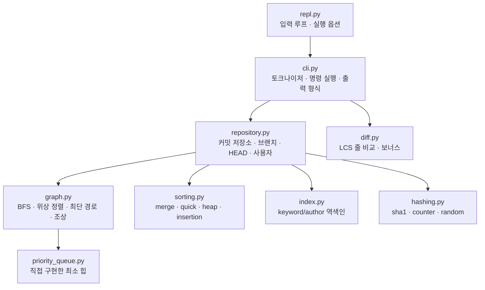

# 설계 문서

Mini Git의 데이터 구조, 그래프 알고리즘, 검색·정렬 설계를 정리한 문서입니다.

- [1. 구조 한눈에 보기](#1-구조-한눈에-보기)
- [2. 커밋 그래프](#2-커밋-그래프)
- [3. 그래프 알고리즘](#3-그래프-알고리즘)
- [4. 역색인 검색](#4-역색인-검색)
- [5. 정렬](#5-정렬)
- [6. 커밋 hash](#6-커밋-hash)
- [7. CLI 문법과 에러](#7-cli-문법과-에러)
- [8. 설계 결정 기록](#8-설계-결정-기록)

---

## 1. 구조 한눈에 보기



| 모듈 | 책임 | 의존하지 않는 것 |
| --- | --- | --- |
| `repl.py` | 프롬프트, 입력 읽기, 실행 옵션(hash 모드, 가짜 시계) | 명령 의미 |
| `cli.py` | 한 줄 → 토큰, 명령 분기, 옵션 파싱, 출력 형식, 에러 메시지 | 알고리즘 구현 |
| `repository.py` | 커밋/브랜치/HEAD/사용자 상태와 일관성 유지 | 출력 형식 |
| `graph.py` | 그래프 탐색 알고리즘 (순수 함수) | `Repository` 클래스 |
| `sorting.py` | 정렬 알고리즘 (순수 함수) | 커밋이라는 개념 |
| `index.py` | 역색인 구축과 조회 | 그래프 |
| `hashing.py` | 유일한 커밋 hash 생성 | 저장소 내부 구조 (존재 여부 콜백만 받음) |

알고리즘 모듈(`graph.py`, `sorting.py`, `index.py`)은 저장소를 전혀 모르고 **함수와 값만** 주고받습니다. 그래서 무작위 그래프로 단위 테스트를 하고, 같은 BFS를 PATH와 ANCESTORS와 MERGE가 함께 씁니다.

## 2. 커밋 그래프

### 2.1 데이터 구조

```python
@dataclass(frozen=True)
class Commit:
    hash: str
    message: str
    author: str
    timestamp: datetime
    parents: tuple[str, ...]   # 0개(루트), 1개(일반), 2개(merge)
    seq: int                   # 생성 순번 — 같은 시각 커밋의 동률 처리
    branch: str                # 만들 때의 브랜치 (LOG 표시용)
```

| 저장소 필드 | 구조 | 용도 | 비용 |
| --- | --- | --- | --- |
| `commits` | `dict[hash → Commit]` | hash로 커밋 조회 | 평균 O(1) |
| `children` | `dict[hash → [hash]]` | 부모 → 자식 방향 탐색 | O(1) 조회 |
| `generation` | `dict[hash → int]` | 조상 판정 가지치기 (루트 1, 그 외 1 + max(부모)) | O(1) |
| `branches` | `dict[name → hash \| None]` | 브랜치 끝 커밋 | O(1) |
| `head` | `str` (브랜치 이름) | 현재 브랜치 | — |
| `user` | `str` | 현재 작성자 | — |
| `index` | `InvertedIndex` | keyword/author 검색 | O(1) 조회 |

**HEAD → 브랜치 → 커밋** 2단 구조입니다. HEAD가 커밋을 직접 가리키지 않고 브랜치 이름을 가리키기 때문에, COMMIT하면 "HEAD가 가리키는 브랜치"의 끝만 새 커밋으로 옮기면 됩니다. SWITCH는 HEAD의 브랜치 이름만 바꿉니다.

### 2.2 COMMIT 한 번에 일어나는 일

```
COMMIT "Add login"
 1) parent = branches[head]                 # 현재 브랜치 끝 (없으면 루트 커밋)
 2) hash   = HashGenerator.generate(...)    # 저장소에 없는 값이 나올 때까지
 3) commits[hash] = Commit(...)             # 저장
 4) children[parent].append(hash)           # 역방향 간선
 5) generation[hash] = generation[parent] + 1
 6) branches[head] = hash                   # 브랜치 이동
 7) index.add(hash, message, author)        # 역색인 갱신 ← 커밋 생성과 같은 시점
```

### 2.3 왜 DAG가 보장되는가

새 커밋의 부모는 **이미 존재하는 커밋**만 될 수 있고, 커밋은 불변(`frozen=True`)이라 나중에 부모를 바꿀 수 없습니다. 간선은 항상 "새 커밋 → 과거 커밋" 방향이므로 생성 순번이 엄격히 감소하는 방향으로만 이어집니다. 순번이 계속 줄어드는 경로가 출발점으로 돌아올 수는 없으니 사이클이 생길 수 없습니다. 위상 정렬(Kahn)이 모든 커밋을 출력했는지 검사해 이 성질을 실행 중에도 확인하고(`CycleError`), 무작위 300회 브랜치/커밋/merge 후에도 DAG인지 테스트합니다(`tests/test_repository.py::DagInvariantTest`).

## 3. 그래프 알고리즘

그래프 함수는 "이웃을 알려주는 함수"를 인자로 받습니다. 같은 BFS가 간선 방향만 바꿔 여러 명령에 재사용됩니다.

| 명령 | 이웃 함수 | 알고리즘 | 복잡도 |
| --- | --- | --- | --- |
| `LOG` | `parents_of` + `children_of` | Kahn 위상 정렬 + 우선순위 큐 | O((V+E) log V) |
| `ANCESTORS` | `parents_of` (부모 방향만) | BFS + 방문 표시 | O(V+E) |
| `PATH` | `neighbors_of` (부모 + 자식, 무방향) | target에서 BFS → greedy 복원 | O(V+E) |
| `MERGE` 판정 | `parents_of` | BFS 조기 종료 + generation 가지치기 | 최악 O(V+E), 보통 훨씬 작음 |

### 3.1 LOG — "부모가 먼저" 위상 정렬 (Kahn 알고리즘)

```
indegree[c] = 부모 수
ready = 부모가 없는 루트 커밋들 (우선순위 큐, 기준: timestamp → seq)
while ready:
    c = ready에서 우선순위가 가장 높은(가장 오래된) 커밋 꺼내기 → 출력
    for child in children[c]:
        indegree[child] -= 1
        if indegree[child] == 0: ready에 넣기     ← 부모를 모두 출력한 자식만 출력 가능
출력 개수 < 전체 개수 → 사이클 (CycleError)
```

"출력 가능" 조건이 "모든 부모가 이미 출력됨"이므로 부모가 항상 자식보다 먼저 나옵니다. merge 커밋은 부모 2개를 모두 출력한 뒤에야 나옵니다. 우선순위 큐는 "출력 가능한 커밋이 여러 개일 때 무엇을 먼저 낼지"만 결정합니다. 기준을 바꾸면 같은 제약 아래 다른 순서를 만들 수 있습니다(`LOG --sort-by=author --topo`).

### 3.2 PATH — 무방향 최단 경로 + 사전순 최소

```
1) target에서 BFS → remaining[x] = x에서 target까지 남은 간선 수
2) source가 remaining에 없으면 "No path"
3) node = source에서 시작해, remaining이 정확히 1 작은 이웃 중 hash가 가장 작은 것으로 이동
```

- **왜 BFS인가**: 간선 가중치가 모두 1이므로 BFS가 처음 도달한 거리가 최단 거리입니다. 다익스트라는 불필요합니다.
- **왜 target에서 BFS하는가**: 각 노드에서 "target까지 남은 거리"를 알아야, source 쪽에서 한 칸씩 고를 때 그 선택이 최단 경로 위에 있는지 바로 판단할 수 있습니다.
- **왜 greedy가 사전순 최소인가**: 후보 경로들은 앞부분이 같고, 처음 갈라지는 위치의 hash가 문자열 비교 결과를 결정합니다. 그 위치에서 가장 작은 hash를 고르면 뒤가 무엇이든 이깁니다. 짧은 hash가 긴 hash의 접두사인 경우(`abc` vs `abcd`)에도 구분자 `-`가 16진수 문자보다 작아 결론이 같습니다. 이 성질은 "모든 최단 경로를 나열해 문자열 최소를 고르는" 정답지와 무작위 그래프 80개에서 비교 검증합니다.
- **왜 무방향인가**: 형제 브랜치 커밋(예: `feature`의 커밋과 `main`의 커밋)은 서로 조상 관계가 아니라서 방향 그래프로는 경로가 없습니다. 무방향으로 보면 공통 조상을 거쳐 "두 커밋이 갈라진 지점까지 거리"를 구할 수 있습니다.

### 3.3 ANCESTORS — 방문 표시가 있는 BFS

부모 방향으로만 BFS합니다. merge 때문에 같은 조상에 여러 경로로 도달하지만(다이아몬드), 방문 표시가 있어 한 번만 출력됩니다. 가까운 조상부터(거리 순) 출력합니다.

### 3.4 MERGE 판정 — generation number 가지치기

"대상 브랜치 끝이 현재 HEAD의 조상인가?"를 묻기 위해 HEAD에서 부모 방향으로 탐색합니다. 처음 구현은 조상 전체를 BFS했는데, 10만 커밋 벤치마크에서 COMMIT/merge 처리량이 초당 1,880건까지 떨어졌습니다(프로파일링 결과 실행 시간의 88%가 이 BFS). 두 가지로 개선했습니다.

1. **조기 종료**: 대상을 만나는 순간 True
2. **generation 가지치기**: `generation(X) < generation(대상)`이면 X의 조상은 모두 더 작으므로 대상이 있을 수 없음 → 더 내려가지 않음 (Git commit-graph와 같은 방법)

개선 후 같은 조건에서 초당 57,241건으로 약 30배 빨라졌습니다([`benchmark.md`](benchmark.md)).

## 4. 역색인 검색

```
COMMIT 시점                               SEARCH 시점
"Fix login bug" ─tokenize─▶ fix, login, bug   SEARCH login ─▶ by_keyword["login"] = [c2, c3]
                     │                                              (전체 커밋을 보지 않음)
by_keyword["fix"].append(h)
by_keyword["login"].append(h)
by_keyword["bug"].append(h)
by_author["alice"].append(h)
```

- **키워드 추출**: 공백 split → lower (과제 최소 기준) + 앞뒤 문장부호 제거(`login,` = `login`) + 같은 메시지 안 중복 제거
- **작성자 키**: 앞뒤/중복 공백 정리 + `casefold()` (`Alice` = `alice`)
- **갱신 시점**: COMMIT·MERGE가 커밋을 저장하는 바로 그 함수(`_new_commit`)에서. 커밋 저장과 색인 갱신이 한 곳에 있어 둘이 어긋날 수 없습니다.
- **posting 순서**: 항상 목록 끝에 추가하므로 별도 정렬 없이 생성순입니다.
- **여러 단어 검색**: AND. 가장 짧은 posting을 기준으로 나머지 posting(집합)에 있는지 확인합니다.

| | 순회 검색 | 역색인 |
| --- | --- | --- |
| 검색 1회 | O(N × 메시지 길이) | O(1) 조회 + O(k) 결과 |
| 커밋 1회 | O(1) | O(토큰 수) |
| 10만 커밋에서 실측 | 171.8 ms | 5.6 ms (결과 19,569건 출력 포함) |

## 5. 정렬

`sorting.py`에 4개 알고리즘을 같은 시그니처 `algo(items, key=None, reverse=False)`로 구현했습니다. 비교 기준은 `key` 함수로 바꾸고, 키는 원소당 한 번만 계산합니다(테스트로 호출 횟수 확인).

| 알고리즘 | 평균 | 최악 | 공간 | 안정 | 이 프로젝트에서 |
| --- | --- | --- | --- | --- | --- |
| merge (기본) | O(n log n) | O(n log n) | O(n) | ✅ | LOG 정렬 기본값. 안정성이 필요해서 |
| quick | O(n log n) | O(n²) | O(log n) | ❌ | 비교 실험용, 동률 많을 때 가장 빠름 |
| heap | O(n log n) | O(n log n) | O(1) | ❌ | 비교 실험용 |
| insertion | O(n²) | O(n²) | O(1) | ✅ | 거의 정렬된 입력에 O(n) |

**기본값이 병합 정렬인 이유**: `LOG --sort-by=author`는 같은 작성자 커밋이 많습니다. 먼저 시간순으로 정렬한 목록을 작성자 기준으로 **안정 정렬**하면 같은 작성자 안에서 시간 순서가 자동으로 유지됩니다. 불안정 정렬이면 동률 처리 기준(timestamp)을 키에 직접 넣어야 합니다. 최악에도 O(n log n)이 보장된다는 점도 이유입니다.

**퀵 정렬 구현에서 발견한 문제**: 처음에는 처음·중간·끝 위치의 중앙값을 피벗으로 썼는데, 3-way 분할이 오른쪽 구간을 특정 패턴으로 재배치하는 바람에 이미 정렬된 2만 개 입력에서 비교 횟수가 300만 번(무작위 입력의 7배)까지 늘었습니다. 무작위 위치 세 개의 중앙값으로 바꾸고 시드를 고정해 재현성은 유지했고, 비교 횟수는 46만 번으로 돌아왔습니다.

## 6. 커밋 hash

| 모드 | 방식 | 재현성 | 디버깅 | 언제 |
| --- | --- | --- | --- | --- |
| `sha1` (기본) | 순번·작성자·시각·메시지·부모의 SHA-1 앞 7자 | 같은 입력이면 같음 | hash만 보고는 순서 모름 | 실제 Git과 같은 내용 기반 |
| `counter` | 순번을 16진수 7자리 (`0000001`) | 항상 같음 | hash가 곧 생성 순서 | 테스트, 예시 문서 |
| `random` | 28비트 난수 | `--seed` 주면 같음 | 실행마다 다름 | 실제 Git처럼 예측 불가 |

**유일성 보장**: 모든 모드가 "저장소에 이미 있는가" 콜백으로 후보를 검사합니다. 충돌하면 hash를 한 글자씩 늘리고(Git의 축약 hash 확장과 같은 아이디어), 40자를 다 써도 충돌하면 순번을 섞어 다시 계산합니다. 500개 연속 생성 테스트와 강제 충돌 테스트로 확인합니다.

## 7. CLI 문법과 에러

| 규칙 | 구현 |
| --- | --- |
| 명령어 대소문자 무시 | `tokens[0].lower()`로 핸들러 조회 |
| 공백 포함 인자는 따옴표 | 직접 만든 토크나이저. `\"`만 이스케이프하고 나머지 역슬래시는 그대로(Windows 경로 `C:\dev\a.txt`) |
| 옵션 형식 `--name=value` | `split_options()`가 위치 인자와 옵션을 분리 |
| 자유 문자열(COMMIT/SEARCH/INIT/USER) | 따옴표 없이 여러 단어를 쓰면 공백으로 이어 붙임 (입력 편의) |
| 커밋 참조 | 전체 hash → 브랜치 이름 → 4자 이상 축약 hash (모호하면 에러) |

| 에러 | 언제 |
| --- | --- |
| `Invalid args` | 인자 개수/형식 오류 (필요하면 `: 이유` 덧붙임) |
| `Unknown branch: <name>` | SWITCH/MERGE 대상 브랜치 없음 |
| `Unknown commit: <hash>` | PATH/ANCESTORS 대상 커밋 없음 |
| `Not initialized. Run: INIT <user_name>` | INIT 전에 다른 명령 |
| `Branch already exists: <name>` | 중복 브랜치 |
| `Unknown command: <cmd> (type HELP)` | 없는 명령 |

에러는 `MiniGitError` 하위 클래스로 던지고 `CommandRunner.execute()` 한 곳에서 문자열로 바꿉니다.

## 8. 설계 결정 기록

| 결정 | 선택 | 이유 |
| --- | --- | --- |
| LOG 2차 기준 | (timestamp, seq) 오름차순 | 같은 조건이면 오래된 커밋 먼저 → 시간 흐름대로 읽힘 |
| `LOG --sort-by` 방향 | 오름차순 (오래된 것/알파벳 먼저) | 기본 LOG(부모 먼저)와 같은 방향이라 비교하기 쉬움 |
| 작성자 정렬 동률 | 시간순 (안정 정렬로 자연스럽게) | "같은 작성자의 작업 흐름"이 보이도록 |
| 커밋 없는 상태에서 BRANCH | 에러 | 가리킬 커밋이 없는 브랜치는 의미가 없음 (Git과 동일) |
| 연결되지 않은 그래프 | `SWITCH --orphan`으로 허용 | `No path`를 실제로 재현할 수 있도록 (Git의 orphan 브랜치) |
| MERGE 대상이 이미 조상 | 커밋 만들지 않음 (`Already up to date.`) | 변화 없는 merge 커밋 방지 |
| 현재 브랜치에 커밋이 없을 때 MERGE | fast-forward | 부모가 하나뿐이라 2-parent 커밋이 성립하지 않음 |
| 시계 주입 | `SystemClock` / `SteppingClock` | 예시 문서와 테스트의 시각을 재현 가능하게 |
